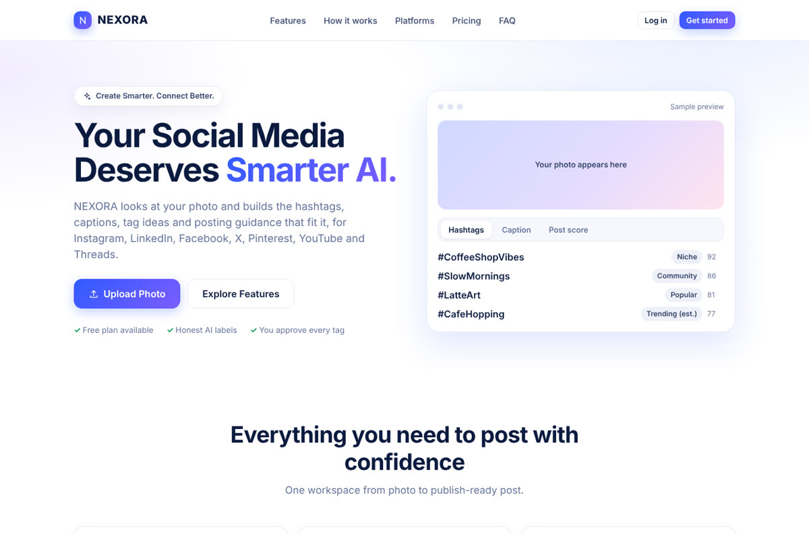
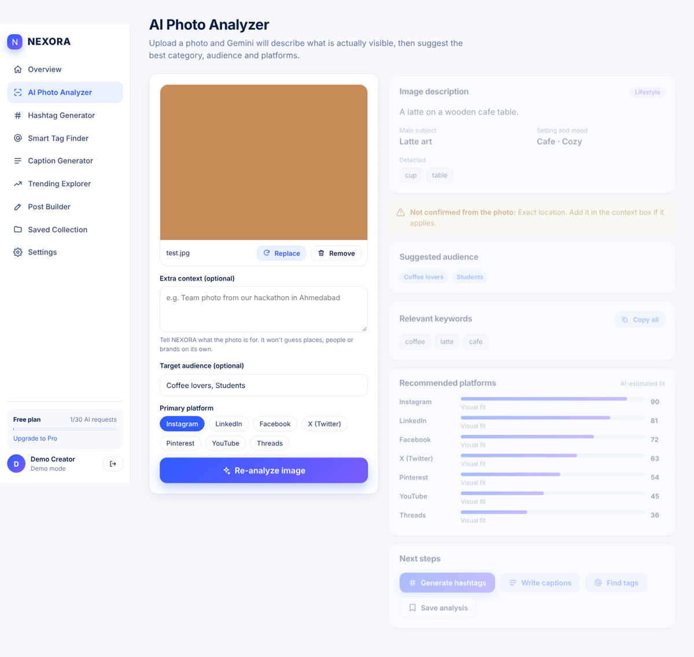
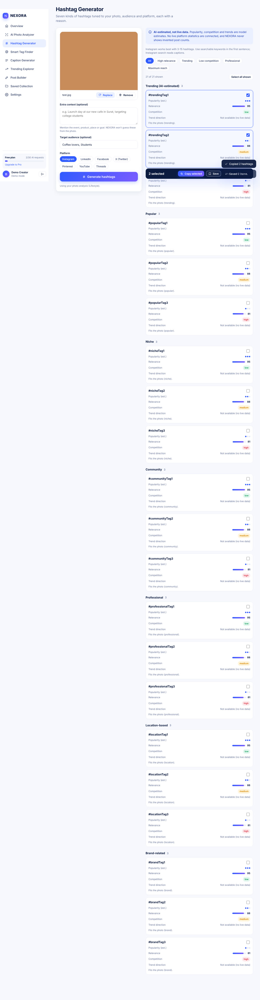
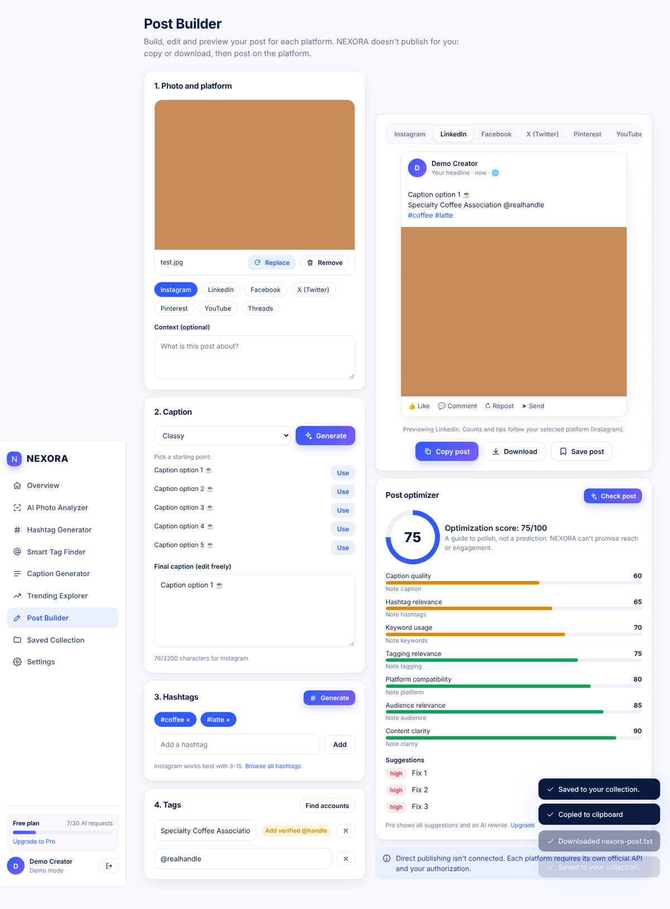
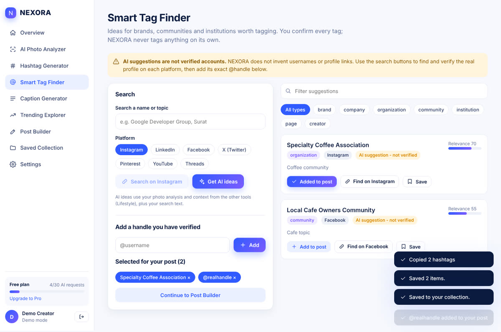
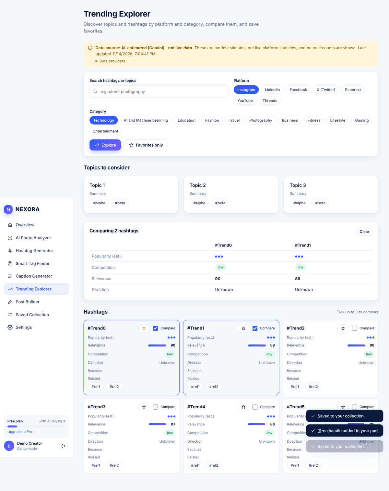
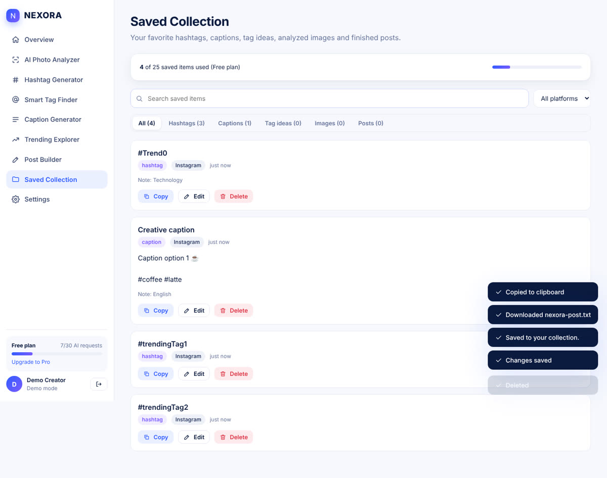
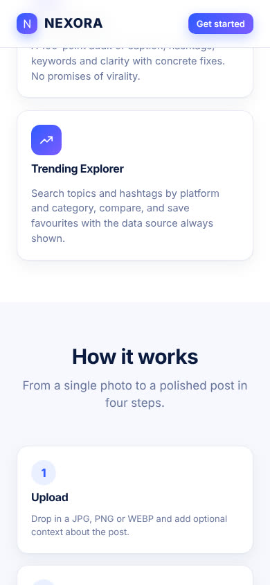

# NEXORA

**Create Smarter. Connect Better.**

NEXORA is an AI social media assistant. Upload a photo and get hashtags, captions and tag ideas made for Instagram, LinkedIn, Facebook, X, Pinterest, YouTube and Threads. Preview and score your post, then copy it and publish yourself. Trends are labeled AI-estimated, and NEXORA never tags or posts for you.

## Features
- **AI Photo Analyzer** (Gemini): describes what is visible, flags what it can't confirm, suggests category, audience, keywords and platforms
- **Hashtag Generator**: 7 groups with relevance, competition and reasons; filters and one-click copy
- **Smart Tag Finder**: unverified brand/community ideas; you add real handles yourself
- **Caption Generator**: 10 styles in English, Hindi, Gujarati and Hinglish
- **Post Optimizer**: 100-point score with fixes (no reach guarantees)
- **Trending Explorer**, **Post Builder** (per-platform previews), **Saved Collection**, **Dashboard**
- Free / Pro usage limits (preview only, no payments), Demo Mode without Firebase, installable as a PWA

## Screenshots
Captured with sample AI responses, not live Gemini output.

| | |
|---|---|
|  |  |
|  |  |
|  |  |
|  |  |

## Videos
Made with sample AI responses (not live Gemini output) and no voiceover. Voiceover scripts are in `docs/scripts`.

| File | Format | Length |
|---|---|---|
| [`videos/nexora-intro.mp4`](videos/nexora-intro.mp4) | 16:9 intro | 10 s |
| [`videos/nexora-promo-16s.mp4`](videos/nexora-promo-16s.mp4) | 16:9 promo | 16 s |
| [`videos/nexora-review.mp4`](videos/nexora-review.mp4) | 16:9 hands-on review | 63 s |
| [`videos/nexora-vertical-2min.mp4`](videos/nexora-vertical-2min.mp4) | 9:16 explainer | 2:01 |

## Setup

AI social media assistant: photo analysis, hashtags, tag ideas, captions (English/Hindi/Gujarati/Hinglish), post optimizer, trending explorer, post builder, saved collection, dashboard, Free/Pro limits.

### Run it
```bash
npm install
cp .env.example .env      # then set GEMINI_API_KEY
npm run dev               # http://localhost:5173
```
- `GEMINI_API_KEY` is read **server-side only** (`api/ai.ts`). The Vite dev server mounts the same handler at `/api/ai`; on Vercel, `api/ai.ts` deploys as a serverless function (set the env var in the project settings). Without a key, AI features show a clear "not configured" error.
- `npm run build` type-checks and builds.

## Firebase (optional)
Leave `VITE_FIREBASE_*` blank to run in **Demo Mode** (local accounts + localStorage, "Continue with demo account").
To enable Google Sign-In, email/password and Firestore sync: create a Firebase project, enable Google and Email/Password providers, create Firestore, fill the four `VITE_FIREBASE_*` values, and use rules like:
```
match /users/{uid}/{document=**} { allow read, write: if request.auth != null && request.auth.uid == uid; }
```

## Honesty rules built in
- Hashtag popularity/competition/trends are labelled **AI-estimated**; no post counts are ever shown. Add a live provider by implementing `TrendProvider` in `src/lib/providers.ts` (keep its key server-side).
- Tag suggestions are unverified display names. No usernames or URLs are invented; "Find on platform" opens that platform's own search. Only `@handles` you type are put in the post, and nothing is tagged without your action.
- No direct publishing and no payments. Plan switching in Settings is a preview of limits only.

## Structure
`api/ai.ts` Gemini function · `src/lib` (ai, store, auth, plans, providers) · `src/components` · `src/pages`

## Install on your phone (PWA)
Deploy over HTTPS (e.g. `vercel` from this folder, with `GEMINI_API_KEY` set in project env vars), open the URL on your phone, then:
- **Android (Chrome):** menu ⋮ → *Install app* / *Add to Home screen*
- **iPhone (Safari):** Share → *Add to Home Screen*
It then launches full-screen with the NEXORA icon. The AI needs an internet connection.
